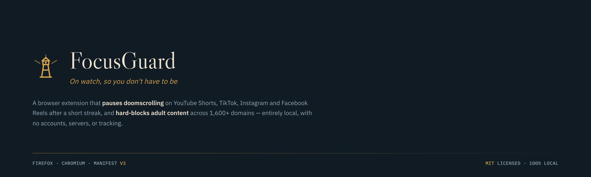
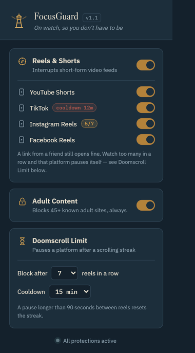
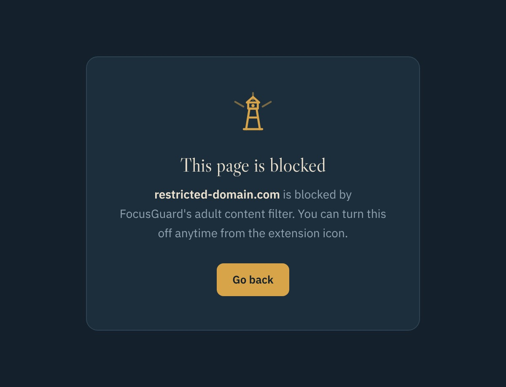
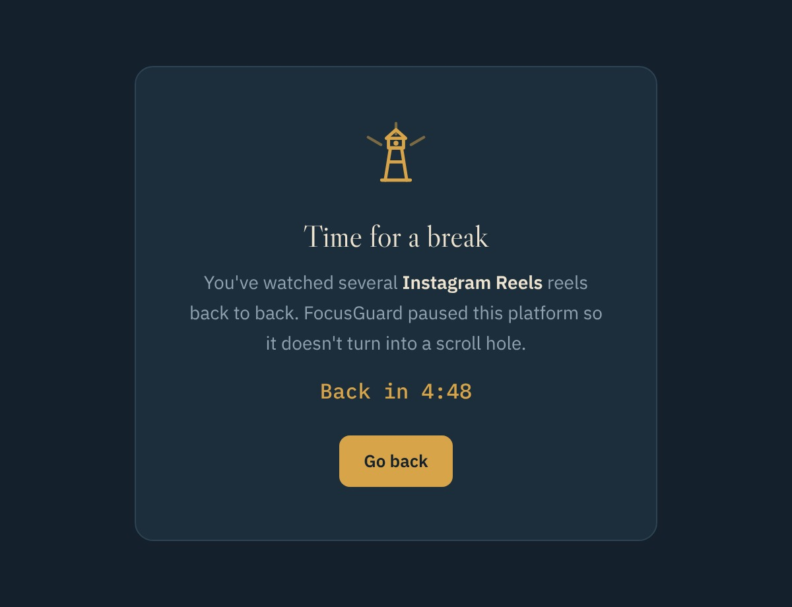
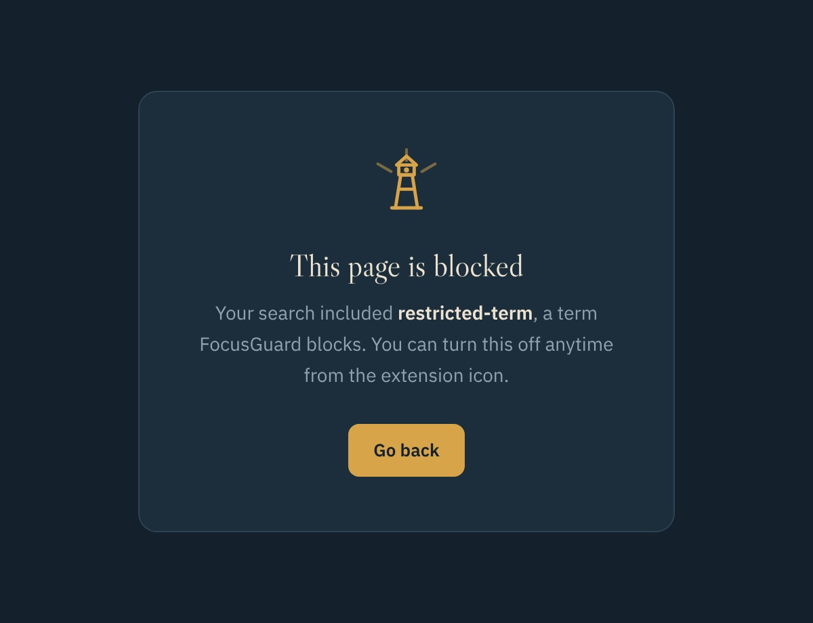

<div align="center">
  
</div>

<br/>

<div align="center">

[](https://addons.mozilla.org/en-US/firefox/addon/focusguard-mindful-browsing/)
[](#-install--chromium)
[](https://developer.chrome.com/docs/extensions/mv3/)
[](LICENSE)

</div>

<br/>

**FocusGuard** is a browser extension that quietly works in the background to keep you on track:

- 🔒 **Adult content** — hard-blocked at the navigation layer across 1,600+ domains and TLDs.
- 📱 **Reels & Shorts** — not blocked outright (a friend's link still opens), but each platform tracks your streak and pauses itself when you hit your limit.
- ⏳ **Doomscroll Limit** — configurable threshold (5–10 reels) and cooldown (5–60 min). The streak resets if you pause for 90+ seconds.
- 🔍 **Search filter** — intercepts adult-keyword queries on Google, Bing, DuckDuckGo, Brave Search, and 7 other engines before results load.

Everything is stored locally. No accounts, no servers, no tracking.

---

## 📸 Screenshots & Live Demo

<table>
  <tr>
    <td align="center" width="50%">
      
      <br/><sub><b>Live demo</b> — reel streak building, cooldown kicking in, a platform toggled off and on</sub>
    </td>
    <td align="center" width="50%">
      
      <br/><sub><b>Popup</b> — per-platform toggles, live streak/cooldown badges, doomscroll controls</sub>
    </td>
  </tr>
</table>

<p align="center"><sub>Every screenshot and the GIF above are real captures of the actual extension code in this repository — not mockups.</sub></p>

<table>
  <tr>
    <td align="center" width="33.3%">
      
      <br/><sub><b>Adult content</b> — blocked at the navigation layer</sub>
    </td>
    <td align="center" width="33.3%">
      
      <br/><sub><b>Doomscroll break</b> — live countdown, resumes automatically</sub>
    </td>
    <td align="center" width="33.3%">
      
      <br/><sub><b>Search filter</b> — triggered by a blocked search term</sub>
    </td>
  </tr>
</table>

---

## 🦊 Install — Firefox

FocusGuard is **available on Firefox Add-ons (AMO)** — permanent install, no developer mode needed:

<a href="https://addons.mozilla.org/en-US/firefox/addon/focusguard-mindful-browsing/">
  
</a>

1. Click the button above (or search **FocusGuard** on [addons.mozilla.org](https://addons.mozilla.org/en-US/firefox/addon/focusguard-mindful-browsing/)).
2. Click **Add to Firefox** → **Add**.
3. Pin the extension from the toolbar for quick access.

---

## 🌐 Install — Chromium

Chrome, Brave, Edge, Opera, and Vivaldi all support loading unpacked extensions in developer mode.

<details>
<summary><b>Step-by-step</b></summary>

1. Download or clone this repository.
2. Open your browser's extensions page:
   - Chrome / Brave → `chrome://extensions`
   - Edge → `edge://extensions`
   - Opera → `opera://extensions`
3. Turn on **Developer mode** (top-right toggle).
4. Click **Load unpacked**.
5. Select the `chrome/` folder from this repository.
6. Pin the FocusGuard icon from the puzzle-piece menu.

</details>

> Chrome Web Store submission is planned. Until then, load unpacked using the steps above.

---

## 🦊 Install — Firefox (manual / developer)

If you'd prefer to load from source rather than AMO:

<details>
<summary><b>Temporary install (removed on browser restart)</b></summary>

1. Open `about:debugging#/runtime/this-firefox`.
2. Click **Load Temporary Add-on…**
3. Select any file inside the `firefox/` folder (e.g. `manifest.json`).

</details>

<details>
<summary><b>Permanent install from source</b></summary>

Firefox requires extensions to be signed by Mozilla for permanent installs. The easiest path is to use the [AMO listing](https://addons.mozilla.org/en-US/firefox/addon/focusguard-mindful-browsing/).

For self-signing and sideloading, refer to [Mozilla's guide on self-distribution](https://extensionworkshop.com/documentation/publish/self-distribution/).

</details>

---

## ⚙️ How it works

### 🔒 Adult content — hard blocked

One toggle blocks navigation to 1,600+ adult domains across every TLD variant. The block happens at the **navigation layer** (`webNavigation` + salted SHA-256 hash lookup) — domain names are never stored in plaintext in the source code, making the list safe to open-source.

Visiting any blocked domain redirects immediately to the FocusGuard blocked page.

### 📱 Reels & Shorts — smart streak limiter

These platforms are **not** blocked outright — a link from a friend still opens normally. Instead:

- Every reel/short is identified by its ID in the URL (all four platforms update the address bar per video).
- Watch back-to-back and once you hit your threshold (default **7**, configurable 5–10), that platform pauses itself.
- A **"Take a break"** screen appears with a live countdown. The platform stays paused until the cooldown ends (default **15 min**, configurable 5–60 min).
- Pause for more than **90 seconds** between videos and the streak resets — so one video now and one an hour later never triggers it.

The popup shows a live badge next to each platform (e.g. `4/7`) so you can see the streak building, and a `cooldown 12m` badge while paused.

### 🔍 Search filter

On 11 major search engines, FocusGuard checks your query against a keyword list of adult site names before results load. If there's a match, you're redirected to the same blocked page used for adult domains, with the matched term named so you know why.

Covered engines: **Google, Bing, DuckDuckGo, Yahoo, Yandex, Baidu, Ecosia, Startpage, Brave Search, Qwant**.

---

## 🎛️ Configuration

All settings are in the popup — click the FocusGuard icon in your toolbar.

| Setting | Default | Range |
|---|---|---|
| Reels threshold | 7 reels | 5 – 10 |
| Cooldown duration | 15 min | 5, 10, 15, 20, 30, 45, 60 min |
| Streak reset gap | 90 sec | Fixed |
| Adult content filter | On | On / Off |
| Per-platform toggles | All on | Individual on/off |

---

## 🔐 Privacy & permissions

FocusGuard makes **no network requests** and stores everything locally in `browser.storage.local`.

| Permission | Why |
|---|---|
| `storage` | Saves your settings and doomscroll state |
| `declarativeNetRequest` | Required by the API (used during migration cleanup on install) |
| `webNavigation` | Intercepts navigations to check against the adult domain hash set |
| `tabs` | Redirects a tab to the blocked page when a match is found |
| `<all_urls>` (host permission) | Needed by `webNavigation` to observe all navigations |
| Content scripts on social platforms | Detects reel changes via the URL to track your streak |
| Content scripts on search engines | Reads the search query to apply the keyword filter |

> **Adult domain list:** To keep the list open-source without exposing domain names in plaintext, every entry is stored as a salted SHA-256 hash in `adult-hashes.js`. The hash generator script is not committed to the repository.

---

## 📁 Repository layout

```
focusguard/
├── chrome/                  Chrome, Brave, Edge, Opera, Vivaldi
│   ├── manifest.json          MV3 manifest
│   ├── background.js          webNavigation adult blocker (importScripts adult-hashes.js)
│   ├── adult-hashes.js        1,678 salted SHA-256 hashes — no plaintext domains
│   ├── content-reels.js       Streak tracker for YouTube, TikTok, Instagram, Facebook
│   ├── content-search.js      Search query keyword filter (11 engines)
│   ├── popup.html/css/js      Toolbar popup UI
│   ├── blocked.html/js        Blocked & break pages
│   ├── fonts/                 Bundled web fonts (offline-safe)
│   └── icons/
├── firefox/                 Firefox 115+ (same files, different manifest)
│   └── ...
├── docs/                    Screenshots and banner used in this README
├── .gitignore               Excludes the hash generator script
├── LICENSE                  MIT
└── README.md
```

---

## 📝 Notes & limitations

- **Reel detection** keys off the video ID in the URL rather than video-load events, since some platforms preload or reuse `<video>` elements in ways that don't line up with what's on screen.
- **Self-managed limiter**: a determined user can disable the extension to bypass the doomscroll limit — same as any personal focus tool. It's built to interrupt casual scrolling, not to be tamper-proof.
- **Adult domain list**: covers 80+ high-traffic brands across 1,600+ TLD variants. It won't catch every site on the internet. The hash generator script (not committed) is where you'd add more.
- **Platform changes**: if YouTube, TikTok, Instagram, or Facebook change their URL structure, `inReelsContext()` and `currentReelId()` in `content-reels.js` are the place to update.

---

## 🤝 Contributing

Issues and pull requests are welcome.

- **Bug reports**: open an issue with the browser version, extension version, and steps to reproduce.
- **New domains**: add them to the generator script and re-run it — the output `adult-hashes.js` is what gets committed.
- **Platform fixes**: `content-reels.js` is the file to edit for reel detection; each platform has its own `inReelsContext()` and `currentReelId()` implementation.

---

## 📜 License

[MIT](LICENSE) — © 2026 Mohamed Seif El Islam Benatallah ([MohamedBen21](https://github.com/MohamedBen21))

Free to use, modify, and distribute. See [LICENSE](LICENSE) for the full text.